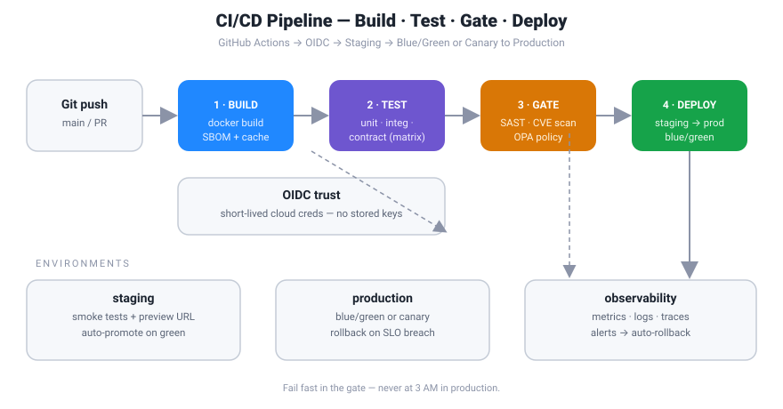

# CI/CD Pipeline Guide


**TL;DR:** Ship cloud-native apps faster *and* safer. This guide collects production-shaped CI/CD pipeline patterns — build → test → security-gate → deploy with GitHub Actions, OIDC to your cloud provider, and zero-downtime strategies (blue/green, canary, rolling). Copy the workflows, adapt the YAML, pass the quiz.

## Why most pipelines fail (and this one won't)

Most CI/CD setups die from one of three sins: **slow feedback loops** (45-minute builds), **leaky secrets** (long-lived cloud keys in repo secrets), and **scary deploys** (straight to prod, fingers crossed). Every pattern below is designed to fix at least one of them.

## Architecture



The pipeline has four stages:

1. **Build** — multi-arch Docker images, cached layers, SBOM attached.
2. **Test** — unit → integration → contract tests, in parallel matrices.
3. **Gate** — SAST/DAST, dependency scanning, image CVE scan, policy-as-code (OPA).
4. **Deploy** — OIDC-authenticated push to staging, then blue/green or canary to prod with automatic rollback on SLO breach.

## Deployment strategy comparison

| Strategy | Downtime | Rollback | Cost | Best for |
|---|---|---|---|---|
| Rolling | ~Zero (brief) | Slow | 1× infra | Stateful apps, tight budgets |
| Blue/Green | Zero | Instant | 2× infra during switch | Stateless APIs, regulated releases |
| Canary | Zero | Fast | ~1.1× infra | User-facing apps, risky changes |
| Feature flags | Zero | Instant (toggle) | App-level | Trunk-based teams |

## Quick start

Copy the workflow into your repo:

```yaml
# .github/workflows/deploy.yml
name: deploy
on:
  push:
    branches: [main]

permissions:
  id-token: write   # OIDC — no stored cloud keys
  contents: read

jobs:
  deploy:
    runs-on: ubuntu-latest
    environment: production
    steps:
      - uses: actions/checkout@v5
      - uses: aws-actions/configure-aws-credentials@v4
        with:
          role-to-assume: arn:aws:iam::123456789012:role/github-actions-deploy
          aws-region: ap-southeast-1
      - run: kubectl set image deploy/api api=$IMAGE --record
```

See `pipeline.py` for a Python helper that validates pipeline configs before they run, and `quiz.md` to test what you learned.

## Repo contents

| File | What it is |
|---|---|
| `README.md` | This guide |
| `architecture.svg` | Pipeline architecture diagram |
| `pipeline.py` | Python validator for pipeline configs (fail fast, not at 3 AM) |
| `quiz.md` | 5 questions — prove you actually read the README |

---

*Part of a daily cloud-engineering notes series. Contributions welcome via PR.*
